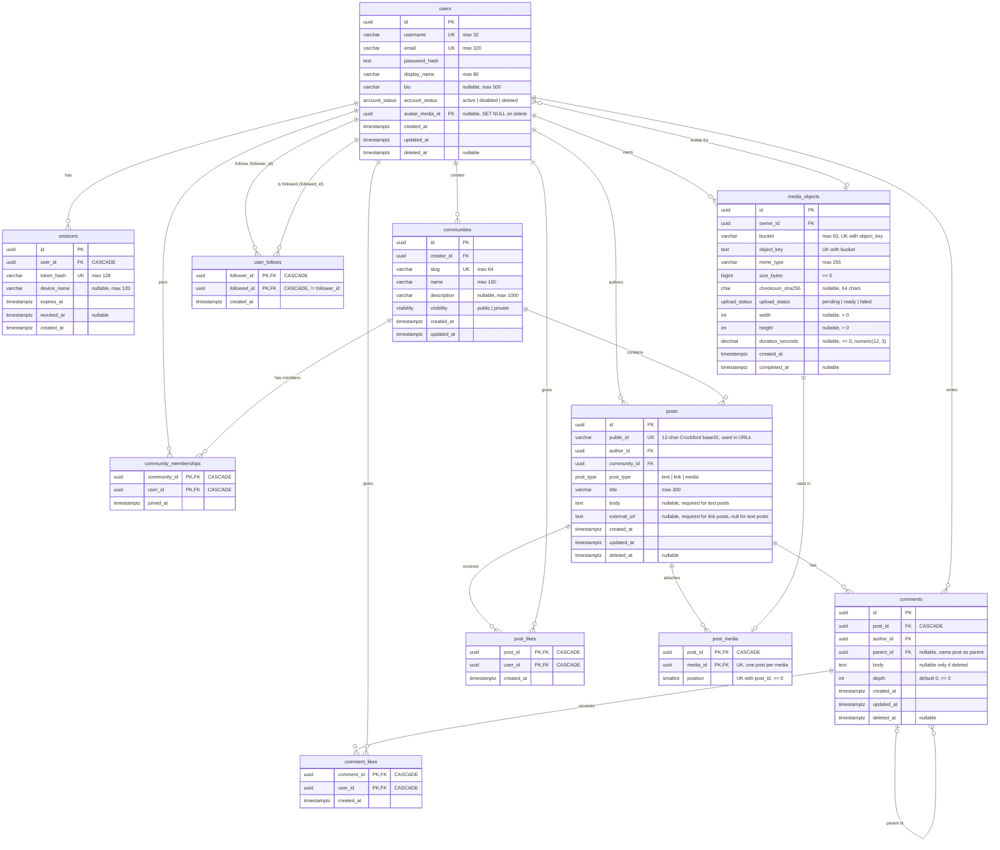

# Database ERD

Generated from [backend/prisma/schema.prisma](../backend/prisma/schema.prisma), including the `comment_depth` and `post_public_id` migrations.

## Notes

- **`posts.id` vs `posts.public_id`:** `id` is the internal key. Other tables use it for their foreign keys. `public_id` is the short ID that the API and URLs use (for example, `/api/posts/R14SZSWA4B69`).
- **`comments.depth`:** a comment on a post has depth 0. A reply has the depth of its parent plus 1. The API uses `parent_id` to send comments as a tree.
- **Post type rules:** these apply only while `deleted_at` is null. Media posts have no body or URL rules.
